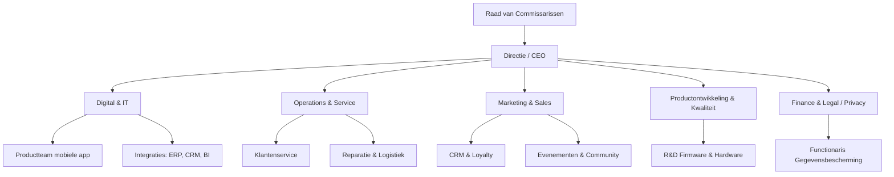
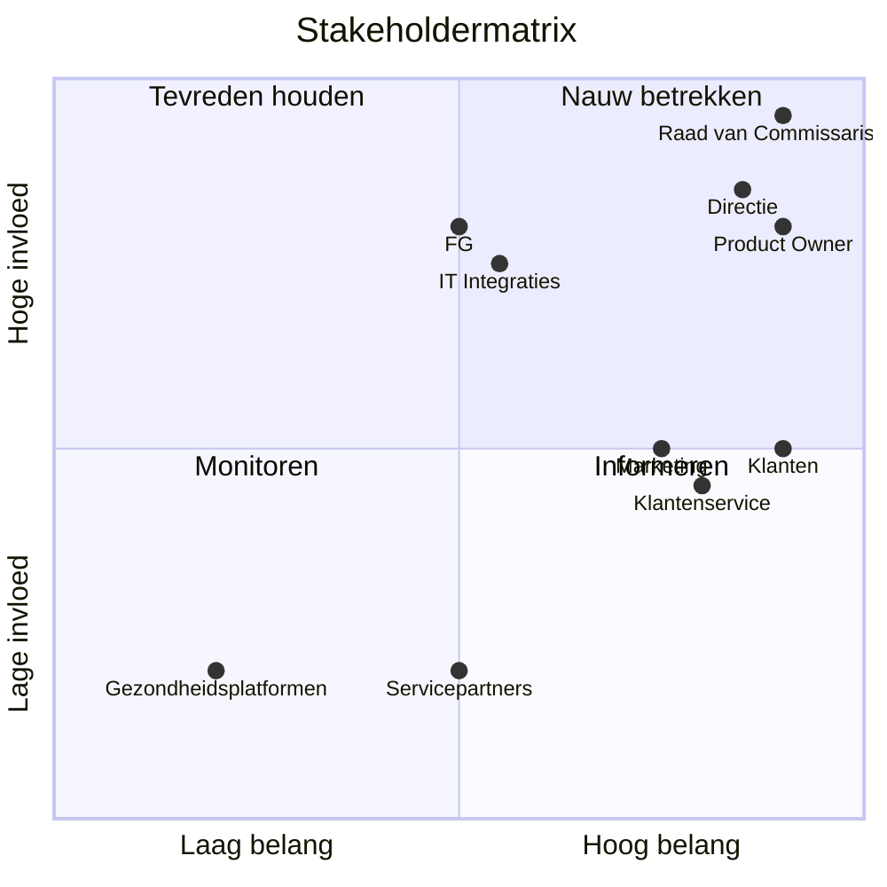
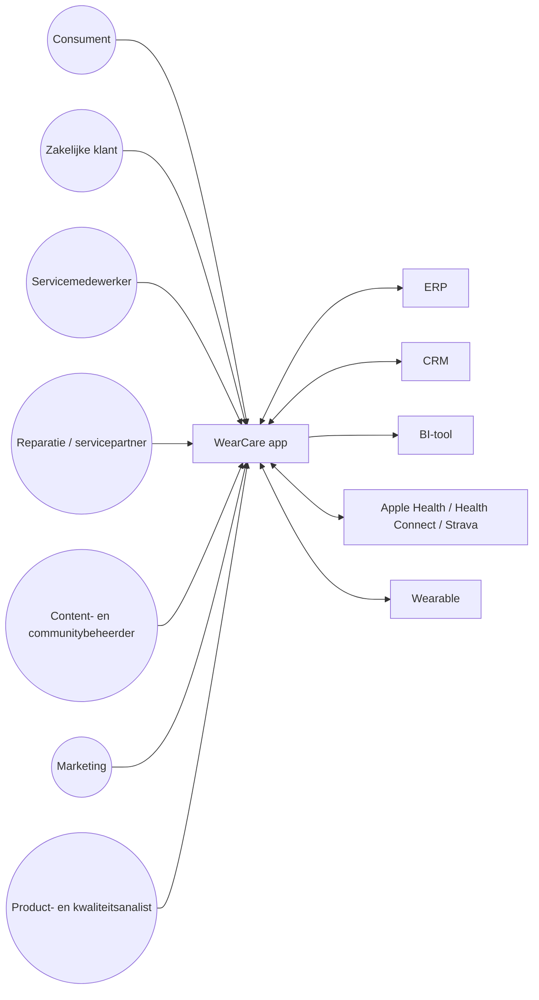
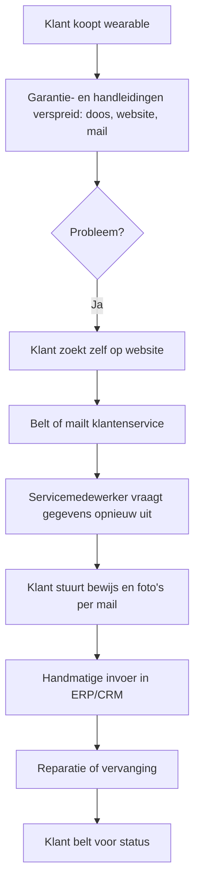
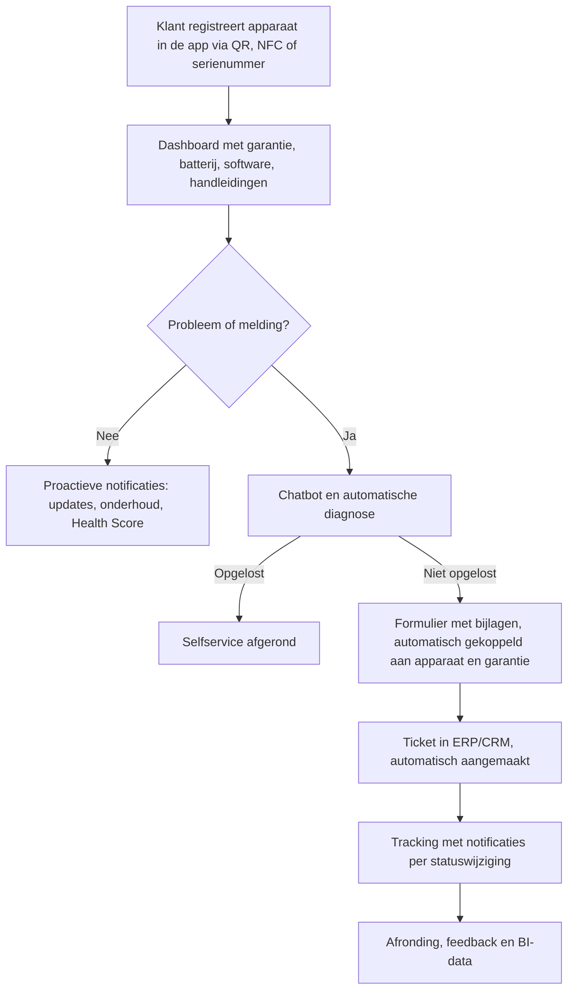

# Requirementsspecificatie: WearCare, de mobiele app van de Watches & Wearables Company

> **Status:** concept v0.1 · **Datum:** 17 november 2026 · **Team:** _[teamnaam en teamleden invullen]_

## Inhoudsopgave

1. [Inleiding](#1-inleiding)
2. [Organisatorische context](#2-organisatorische-context)
3. [Actoren van het systeem](#3-actoren-van-het-systeem)
4. [Bedrijfsprocesanalyse](#4-bedrijfsprocesanalyse)
5. [Productvisie](productvisie.md)
6. [User stories, DoR en DoD](user-stories.md)
7. [Domeinmodel, sitemap en wireframes](ontwerp.md)

---

## 1. Inleiding

### 1.1 Doel van dit document
Dit document beschrijft het **wat, hoe en waarom** van de mobiele applicatie **WearCare** (werktitel) voor de Watches & Wearables Company (hierna: *W&W*). Het beschrijft de context, de actoren, het proces dat de app ondersteunt en de knelpunten daarin. Daaruit volgt een productvisie, die is uitgewerkt in user stories voor het ontwikkelteam, een domeinmodel, een sitemap en wireframes.

### 1.2 Aanleiding
De raad van commissarissen heeft besloten dat alle bedrijven binnen de organisatie een mobiele app ontwikkelen die de klantervaring verbetert en de klantloyaliteit versterkt. De app is het centrale platform voor alles rondom aangeschafte smartwatches, sporthorloges, activity trackers, wearables, accessoires, abonnementen en digitale diensten.

### 1.3 Scope
**Binnen scope:** registratie van apparaten, dashboard, notificaties, kennisbibliotheek, bestellen via ERP, garantie/reparatie/support, AI-chatbot en live chat, personalisatie, community en gamification, winkel- en servicepuntzoeker, evenementen, privacy en beveiliging, integraties (ERP, CRM, BI, Apple Health, Google Health Connect, Strava), toegankelijkheid en meertaligheid, plus de unieke functionaliteit (zie 1.4).

**Buiten scope:** de firmware van de wearables zelf, de ontwikkeling van het ERP, CRM en de BI-tool (alleen de koppelingen vallen binnen scope), en fysieke logistiek van reparaties.

### 1.4 Unieke functionaliteit: *Wearable Lifecycle Coach*
De raad vraagt elk team om een unieke functionaliteit die past bij de bedrijfsstrategie. Wij kiezen voor **duurzaamheid en preventief onderhoud**:

- Een **Device Health Score** per apparaat (batterijgezondheid, sensoren, softwarestatus, gebruiksintensiteit).
- **Voorspellend onderhoud:** de app voorspelt wanneer een batterij of band aan vervanging toe is en geeft tips om de levensduur te verlengen (bijvoorbeeld laadgewoonten).
- **Circulaire opties:** reparatie, refurbish of inruil (trade-in) in plaats van vervangen, via de koppeling met het ERP.
- **Impactoverzicht** (bespaarde CO₂ en e-waste) en een gamification-badge *"Duurzame Wearable Expert"*.

Dit sluit aan op bestaande onderdelen: dashboard (batterijstatus), notificaties, reparatieproces, bestellen via ERP, BI-data en gamification.

### 1.5 Aannames
| # | Aanname |
|---|---|
| A1 | De naam *Watches & Wearables Company* is de moedermaatschappij. Het bedrijf waarvoor wij ontwikkelen heet in dit document *W&W*. |
| A2 | De app wordt gebouwd voor iOS en Android (cross-platform, bijvoorbeeld Flutter of React Native). |
| A3 | ERP, CRM en BI beschikken over bruikbare API's. |
| A4 | Alle cijfers in de productvisie zijn **indicatieve doelen**, nog te valideren met W&W. |
| A5 | Het organogram is een veronderstelde weergave, af te stemmen met W&W. |

---

## 2. Organisatorische context

### 2.1 Missie, visie en strategie
_(Waar de casus geen formulering geeft, is deze afgeleid uit de casus. Controleer en pas aan zodra W&W andere formuleringen heeft.)_

| Onderdeel | Beschrijving |
|---|---|
| **Missie** | Mensen helpen gezonder, actiever en slimmer te leven met betrouwbare, goed ondersteunde wearables. |
| **Visie** | Elke W&W-klant heeft een persoonlijk, digitaal ecosysteem rondom zijn wearables waarin alle informatie en service één tik verwijderd is. |
| **Strategie** | Van productverkoper naar *ecosysteemaanbieder*: klantrelatie verlengen na de aankoop via een eigen app, zelfservice en personalisatie. Daarnaast duurzaamheid (langere levensduur van producten) als onderscheidend element. |
| **Kernwaarden** | Klantgerichtheid, innovatie, betrouwbaarheid, privacy, duurzaamheid. |

### 2.2 Strategische doelstellingen (SMART, indicatief)
| # | Doelstelling | Meetbaar doel (12 maanden na livegang) |
|---|---|---|
| D1 | Klantloyaliteit verhogen | NPS +10 punten; 40% van de klanten maandelijks actief in de app |
| D2 | Servicekosten verlagen via selfservice | 30% minder telefonische/e-mail supportcontacten; 50% van de vragen opgelost door chatbot |
| D3 | Omzet uit premium diensten en accessoires verhogen | +15% omzet uit accessoires en abonnementen via de app |
| D4 | Datagedreven productontwikkeling | Maandelijkse BI-rapportage naar productontwikkeling, marketing en kwaliteit |
| D5 | Duurzaamheid | 20% meer reparaties/refurbish ten opzichte van vervangingen |

### 2.3 Organogram (verondersteld)

### 2.4 Stakeholderanalyse (Mendelow: macht / belang)

| Stakeholder | Belang in het project | Invloed | Belang | Strategie |
|---|---|---|---|---|
| Raad van Commissarissen | Opdrachtgever, strategische sturing | Hoog | Hoog | **Nauw betrekken** |
| Directie W&W | Budget, businesscase | Hoog | Hoog | **Nauw betrekken** |
| Product Owner (W&W) | Prioritering backlog | Hoog | Hoog | **Nauw betrekken** |
| Klanten (consumenten) | Eindgebruikers | Middel | Hoog | **Informeren en betrekken (testen, feedback)** |
| Zakelijke klanten | Apparaat- en contractbeheer | Middel | Hoog | **Informeren en betrekken** |
| Klantenservice | Minder tickets, beter gevulde tickets | Middel | Hoog | **Betrekken** |
| Reparatie & Logistiek | Verwerken van reparatieverzoeken | Middel | Middel | **Informeren** |
| Marketing & Sales | Personalisatie, promoties | Middel | Hoog | **Betrekken** |
| Productontwikkeling & Kwaliteit | Gebruiksdata en feedback | Middel | Hoog | **Betrekken** |
| IT / Integratiebeheer | ERP, CRM en BI-koppelingen | Hoog | Middel | **Tevreden houden** |
| Functionaris Gegevensbescherming (FG) | AVG-compliance | Hoog | Middel | **Tevreden houden, tijdig raadplegen** |
| Servicepartners en retailers | Vindbaarheid, doorverwijzing | Laag | Middel | **Informeren** |
| Gezondheidsplatformen (Apple, Google, Strava) | API-voorwaarden | Laag | Laag | **Monitoren** |
| Toezichthouder (AP) | Wetgeving | Hoog | Laag | **Tevreden houden (compliance)** |

---

## 3. Actoren van het systeem

| Actor | Type | Omschrijving | Belangrijkste doelen |
|---|---|---|---|
| **Consument (klant)** | Primair | Particuliere eigenaar van een of meer wearables | Apparaat registreren en beheren, hulp krijgen, accessoires kopen, deelnemen aan community |
| **Zakelijke klant (beheerder)** | Primair | Beheert meerdere apparaten, contracten en licenties voor een organisatie | Apparatenpark overzien, bestellen, contracten en leveringen volgen |
| **Servicemedewerker** | Secundair | Behandelt live chats, terugbelverzoeken en tickets | Klant snel helpen met volledige context |
| **Reparatiemedewerker / servicepartner** | Secundair | Beoordeelt en repareert apparaten | Status bijwerken, juiste informatie over de klacht |
| **Content- en communitybeheerder** | Secundair | Beheert handleidingen, FAQ's, community, badges en uitdagingen | Content actueel en veilig houden |
| **Marketing- en salesmedewerker** | Secundair | Beheert aanbiedingen, campagnes en evenementen | Gepersonaliseerde promoties versturen |
| **Product- en kwaliteitsanalist** | Secundair | Gebruikt BI-inzichten | Trends in gebruik, batterijprestaties en feedback ontdekken |
| **Systeembeheerder** | Secundair | Beheert gebruikers, rollen en configuratie | Beschikbaarheid en beveiliging waarborgen |
| **Functionaris Gegevensbescherming** | Secundair | Bewaakt privacy | Inzage in verwerkingen en verzoeken van betrokkenen |
| **ERP-systeem** | Extern systeem | Voorraad, bestellingen, reparaties | Actuele data leveren en ontvangen |
| **CRM-systeem** | Extern systeem | Klantprofielen en gespreksgeschiedenis | Profielen synchroon houden |
| **BI-tool** | Extern systeem | Analyse van geanonimiseerde data | Inzichten leveren |
| **Gezondheidsplatformen** (Apple Health, Google Health Connect, Strava) | Extern systeem | Gezondheids- en sportdata | Data synchroniseren |
| **Wearable (Bluetooth/NFC)** | Extern apparaat | Levert batterij-, sensor- en softwarestatus | Statusdata sturen |
| **AI-chatbot** | Extern/intern systeem | Beantwoordt veelgestelde vragen | Selfservice 24/7 |

---

## 4. Bedrijfsprocesanalyse

Het proces dat de app ondersteunt is het **after-sales proces**: van registratie van het apparaat tot support, garantie en reparatie. Dit is de plek waar de grootste klantpijn en servicekosten zitten.

### 4.1 SIPOC

| Suppliers | Inputs | Process | Outputs | Customers |
|---|---|---|---|---|
| Klant, retailers/webshop, ERP, CRM, wearable, servicepartners | Serienummer/QR-code/NFC, aankoopbewijs, probleemomschrijving, foto's/logbestanden, garantie- en voorraadgegevens | 1. Apparaat registreren 2. Apparaat monitoren en onderhouden 3. Hulp zoeken (zelfservice) 4. Probleem/garantie/reparatie melden 5. Reparatie uitvoeren en volgen 6. Afronden en feedback | Geregistreerd apparaat, notificaties, diagnose, ticket/reparatiestatus, gerepareerd of vervangen apparaat, BI-data | Klant, zakelijke klant, klantenservice, productontwikkeling, marketing |

### 4.2 Ist-situatie (huidig proces)

### 4.3 Soll-situatie (gewenst proces met de app)

### 4.4 Knelpunten en gap-analyse

| # | Knelpunt (Ist) | Gewenste situatie (Soll) | Gap / oplossing in de app | Epic |
|---|---|---|---|---|
| K1 | Klantgegevens, aankoopbewijs en garantie zijn verspreid of onbekend | Eén registratie met alle gegevens | Registratie via QR/NFC/Bluetooth/handmatig en persoonlijk dashboard | E1, E2 |
| K2 | Klanten missen software-updates, onderhoud en batterijvervanging | Proactieve en tijdige meldingen | Notificaties op basis van apparaatstatus en Device Health Score | E3, E14 |
| K3 | Handleidingen verouderd, moeilijk vindbaar en niet meertalig | Per-apparaat handleidingen, zoekfunctie, meertalig | Kennisbibliotheek met zoekfunctie | E4 |
| K4 | Bestellen van accessoires en onderdelen via externe webshops of verkopers | Direct bestellen in de app | ERP-koppeling met actuele voorraad | E5 |
| K5 | Garantie en reparatie verlopen via telefoon/e-mail; veel heen-en-weer | Gestructureerd formulier met diagnose en tracking | Meldformulier, automatische probleemherkenning, statusvolging | E6 |
| K6 | Hoge servicekosten door veelgestelde vragen | Selfservice en 24/7 ondersteuning | AI-chatbot, live chat en terugbelfunctie met CRM-context | E7 |
| K7 | Weinig inzicht in klantvoorkeuren en gebruik | Gepersonaliseerde aanbiedingen en data voor productontwikkeling | Personalisatie en geanonimiseerde BI-koppeling | E8, E12 |
| K8 | Beperkte klantbetrokkenheid na aankoop | Actieve community en motivatie | Community en gamification | E9 |
| K9 | Onduidelijkheid over privacy en gegevensgebruik | Transparantie en controle | Privacy-instellingen, AVG-compliance, 2FA | E11 |
| K10 | Apparaten worden vervangen in plaats van onderhouden of gerepareerd | Langere levensduur en circulair gebruik | **Wearable Lifecycle Coach** | E14 |
| K11 | Handmatige invoer leidt tot fouten tussen systemen | Consistente data tussen app, ERP, CRM en BI | Integraties | E12 |

Vervolg: [Productvisie](productvisie.md) → [User stories](user-stories.md) → [Ontwerp](ontwerp.md)
