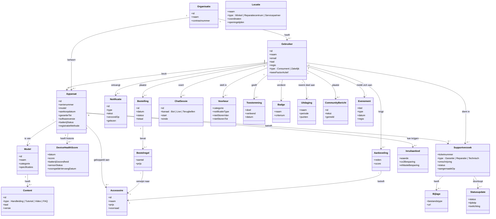

# Ontwerp: domeinmodel, sitemap en wireframes

## 1. Domeinmodel

Het domeinmodel toont de kernbegrippen van WearCare en hun relaties. Klant-, order- en reparatiegegevens zijn *bron-van-waarheid* in CRM/ERP; de app houdt een gesynchroniseerde kopie.



**Toelichting bij de kernrelaties**
- Een **Gebruiker** (consument of zakelijk) heeft nul of meer **Apparaten**; bij zakelijke klanten beheert een **Organisatie** de apparaten.
- Een **Supportverzoek** hoort bij precies één apparaat en gebruiker en doorloopt meerdere **Statusupdates** (elke update leidt tot een **Notificatie**).
- De **Device Health Score** (unieke functie) is een historie per apparaat, waaruit voorspellingen en een **Inruilaanbod** volgen.
- **Toestemming** bepaalt of data voor personalisatie, BI of community gebruikt mag worden.

---

## 2. Sitemap

```mermaid
flowchart TD
    Start([Start / Onboarding]) --> Login[Inloggen / Registreren + 2FA]
    Login --> Home[Home / Dashboard]

    Home --> Apparaten[Mijn apparaten]
    Home --> Hulp[Hulp & Support]
    Home --> Winkel[Winkel]
    Home --> Community[Community]
    Home --> Meer[Meer]

    Apparaten --> A1[Apparaat toevoegen: QR / NFC-Bluetooth / handmatig]
    Apparaten --> A2[Apparaatdetails]
    A2 --> A2a[Specificaties & garantie]
    A2 --> A2b[Device Health Score]
    A2b --> A2b1[Voorspelling & tips]
    A2b --> A2b2[Inruil / refurbish & impact]
    A2 --> A2c[Handleidingen van dit apparaat]
    A2 --> A2d[Accessoires]

    Hulp --> H1[Chatbot 24/7]
    H1 --> H1a[Live chat / Terugbellen]
    Hulp --> H2[Kennisbibliotheek & zoeken]
    H2 --> H2a[Handleiding / Tutorial / Video]
    Hulp --> H3[Probleem melden]
    H3 --> H3a[Diagnose]
    H3 --> H3b[Formulier met bijlagen]
    Hulp --> H4[Mijn verzoeken & status]
    H4 --> H4a[Ticketdetails & tracking]
    Hulp --> H5[FAQ]

    Winkel --> W1[Aanbevolen voor jou]
    Winkel --> W2[Accessoires & onderdelen]
    W2 --> W2a[Productdetail]
    W2a --> W2b[Winkelmand & afrekenen]
    Winkel --> W3[Mijn bestellingen]
    Winkel --> W4[Aanbiedingen & vroege toegang]

    Community --> C1[Feed & berichten]
    Community --> C2[Ideeën & stemmen]
    Community --> C3[Badges, punten, uitdagingen]
    Community --> C4[Evenementen]

    Meer --> M1[Winkel- & servicepuntzoeker]
    Meer --> M2[Notificaties & voorkeuren]
    Meer --> M3[Instellingen: taal, thema, toegankelijkheid]
    Meer --> M4[Account & privacy]
    M4 --> M4a[Toestemmingen, data-export, account verwijderen]
    Meer --> M5[Koppelingen: Apple Health / Health Connect / Strava]
    Meer --> M6[Zakelijk: apparatenpark beheren]
```



---

## 3. Wireframes

Low-fidelity wireframes van de belangrijkste user stories. Voor de definitieve versie kunnen deze in Figma worden uitgewerkt; voeg dan de exportafbeeldingen toe in `docs/wireframes/` en verwijs ernaar in deze sectie.

### WF-1: Dashboard (US-04, US-29)

```text
┌─────────────────────────────────────┐
│ ☰  WearCare                  🔔(2)  │
├─────────────────────────────────────┤
│ Hallo Sanne 👋                      │
│                                     │
│ Mijn apparaten                      │
│ ┌─────────────────────────────────┐ │
│ │ [img]  W&W Pulse 5              │ │
│ │        Health Score: 86/100  ●  │ │
│ │        🔋 78%   Garantie t/m    │ │
│ │        12-2027  Software v3.2   │ │
│ │        ⚠ Update beschikbaar     │ │
│ │                        [Details]│ │
│ └─────────────────────────────────┘ │
│ ┌─────────────────────────────────┐ │
│ │ [img]  W&W Fit Band 2           │ │
│ │        Health Score: 64/100  ▲  │ │
│ │        🔋 91%  ⚠ Batterij over  │ │
│ │        ca. 4 mnd vervangen      │ │
│ │                        [Details]│ │
│ └─────────────────────────────────┘ │
│ [ + Apparaat toevoegen ]            │
│                                     │
│ Voor jou: 🏷 Sportband -15%         │
├─────────────────────────────────────┤
│ 🏠 Home  ⌚ Apparaten  💬 Hulp  🛒  ⋯│
└─────────────────────────────────────┘
```

### WF-2: Apparaat registreren (US-01, US-02, US-03)

```text
┌─────────────────────────────────────┐
│ ←  Apparaat toevoegen               │
├─────────────────────────────────────┤
│ Hoe wil je registreren?             │
│                                     │
│ ┌─────────────────────────────────┐ │
│ │ 📷  Scan QR-code op verpakking  │ │
│ └─────────────────────────────────┘ │
│ ┌─────────────────────────────────┐ │
│ │ 📶  Koppelen via Bluetooth/NFC  │ │
│ └─────────────────────────────────┘ │
│ ┌─────────────────────────────────┐ │
│ │ ⌨️  Serienummer of aankoopbewijs │ │
│ └─────────────────────────────────┘ │
│                                     │
│ Cameratoegang nodig? We vragen het  │
│ eerst. Handmatig kan altijd.        │
└─────────────────────────────────────┘
          │ (na scan)
          ▼
┌─────────────────────────────────────┐
│ ✔ Apparaat gevonden                 │
│ W&W Pulse 5 · SN: PX5-0042-8831     │
│ Aankoop: 14-12-2025                 │
│ Garantie t/m: 14-12-2027            │
│ [ Bevestigen ]    [ Niet mijn apparaat ]│
└─────────────────────────────────────┘
```

### WF-3: Probleem melden (US-12, US-13)

```text
┌─────────────────────────────────────┐
│ ←  Probleem melden                  │
├─────────────────────────────────────┤
│ Apparaat: [ W&W Pulse 5      ▼ ]    │
│ Garantie: ✔ geldig t/m 14-12-2027   │
│                                     │
│ Wat is het probleem?                │
│ (•) Batterij   ( ) Verbinding       │
│ ( ) Sensor     ( ) Synchronisatie   │
│ ( ) Anders                          │
│                                     │
│ ┌─────────────────────────────────┐ │
│ │ 🔍 Diagnose uitgevoerd:         │ │
│ │ Batterijgezondheid 62% – onder  │ │
│ │ drempel. Probeer: [stappen ▸]   │ │
│ └─────────────────────────────────┘ │
│ Omschrijving:                       │
│ ┌─────────────────────────────────┐ │
│ │                                 │ │
│ └─────────────────────────────────┘ │
│ Bijlagen: [📷 Foto] [🎥 Video]      │
│           [📄 Logbestand] (2/5)     │
│                                     │
│ [ Probleem opgelost ]  [ Versturen ]│
└─────────────────────────────────────┘
```

### WF-4: Status volgen (US-14)

```text
┌─────────────────────────────────────┐
│ ←  Reparatie #RP-20417              │
├─────────────────────────────────────┤
│ W&W Pulse 5 – batterijprobleem      │
│ Verwachte afronding: 28 nov 2026    │
│                                     │
│  ●━━ Ontvangen         12 nov       │
│  ●━━ Beoordeling       14 nov       │
│  ◉━━ Reparatie         (bezig)      │
│  ○━━ Verzending                     │
│  ○━━ Afgerond                       │
│                                     │
│ Laatste update: "Nieuwe batterij    │
│ wordt geplaatst."                   │
│                                     │
│ [ 💬 Bericht toevoegen ]            │
│ [ Contact opnemen ]                 │
└─────────────────────────────────────┘
```

### WF-5: AI-chatbot (US-15, US-16)

```text
┌─────────────────────────────────────┐
│ ←  Assistent (AI)        ⓘ          │
├─────────────────────────────────────┤
│ 🤖 Hoi Sanne! Ik ben de AI-assistent│
│    van W&W. Waarmee kan ik helpen?  │
│                                     │
│          Mijn batterij is snel leeg │
│                                  👤 │
│ 🤖 Ik zie dat je Pulse 5 op 62%     │
│    batterijgezondheid zit. Dat      │
│    verklaart het. Wil je tips of    │
│    een vervangingsafspraak?         │
│    [Tips]  [Afspraak]  [Mens spreken]│
│                                     │
│ Was dit nuttig?  👍  👎             │
├─────────────────────────────────────┤
│ [ Typ je vraag…              ] [➤]  │
└─────────────────────────────────────┘
```

### WF-6: Device Health Score en Lifecycle Coach (US-29, US-30, US-31)

```text
┌─────────────────────────────────────┐
│ ←  Health Score · Pulse 5           │
├─────────────────────────────────────┤
│            ┌───────┐                │
│            │  86   │  Goed          │
│            └───────┘                │
│ 🔋 Batterij      78%   ▓▓▓▓▓▓▓░░    │
│ 📡 Sensoren      OK    ▓▓▓▓▓▓▓▓▓    │
│ ⬆ Software      v3.2  ▓▓▓▓▓▓░░░    │
│                                     │
│ Voorspelling                        │
│ Batterij is naar verwachting over   │
│ ca. 9 maanden aan vervanging toe.   │
│ (zekerheid: gemiddeld)              │
│                                     │
│ Tips om langer mee te gaan          │
│ • Laad op tussen 20% en 80%         │
│ • Update naar v3.3                  │
│ [ Alle tips ]                       │
│                                     │
│ 🌱 Jouw impact: 1,2 kg CO₂ bespaard │
│ Badge: Duurzame Wearable Expert (1/3)│
│                                     │
│ [ Repareren ]  [ Inruilen / refurbish ]│
└─────────────────────────────────────┘
```

### WF-7: Winkel en afrekenen (US-10, US-17)

```text
┌─────────────────────────────────────┐
│ ←  Sportband Flex (Pulse 5)         │
├─────────────────────────────────────┤
│ [          afbeelding              ]│
│ €29,95   ✔ Op voorraad (ERP)        │
│ Kleur: (•)Zwart ( )Blauw ( )Groen   │
│ Aanbevolen omdat je Pulse 5 gebruikt│
│ en veel sport.                      │
│                                     │
│ [ In winkelmand ]                   │
└─────────────────────────────────────┘
          │
          ▼
┌─────────────────────────────────────┐
│ ←  Afrekenen                        │
│ 1× Sportband Flex            €29,95 │
│ Verzending                    €0,00 │
│ Totaal                       €29,95 │
│ Betaalmethode: [ iDEAL ▼ ]          │
│ [ Betalen ]                         │
└─────────────────────────────────────┘
```

### WF-8: Privacy-instellingen (US-24)

```text
┌─────────────────────────────────────┐
│ ←  Privacy                          │
├─────────────────────────────────────┤
│ Jij bepaalt wat we gebruiken        │
│                                     │
│ Personalisatie         [ ○──── ]    │
│ Geanonimiseerde analyse[ ○──── ]    │
│ Marketing              [ ○──── ]    │
│ Delen in community     [ ○──── ]    │
│ Koppeling gezondheids- [ ○──── ]    │
│ platformen                          │
│                                     │
│ [ Mijn gegevens bekijken ]          │
│ [ Gegevens exporteren ]             │
│ [ Account verwijderen ]             │
│ Privacybeleid (versie 1.0) ▸        │
└─────────────────────────────────────┘
```

### Koppeling wireframes en user stories

| Wireframe | User stories |
|---|---|
| WF-1 Dashboard | US-04, US-05, US-29 |
| WF-2 Registreren | US-01, US-02, US-03 |
| WF-3 Probleem melden | US-12, US-13 |
| WF-4 Status volgen | US-14 |
| WF-5 Chatbot | US-15, US-16 |
| WF-6 Health Score / Lifecycle Coach | US-29, US-30, US-31 |
| WF-7 Winkel en afrekenen | US-10, US-17 |
| WF-8 Privacy | US-24 |

Terug naar [README](README.md)
